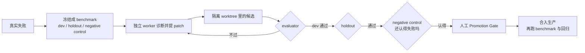

我曾经把 Hermes 的一次真实失败交给 Agent，让它自己找原因、写修复、跑验证。最后合入生产的，不是一句"测试通过"，而是一串不能跳过的东西：冻结的 failure benchmark、dev 与 holdout、negative control、隔离 worktree、独立 evaluator，以及最后的人类批准。

所谓自我纠错，拆开看没有意识，只有一条不允许把"猜到了"直接写成"修好了"的回路。

这次的缺陷很具体：没有配置 profile 时区时，定时任务在跨越夏令时之后仍然沿用固定 offset。表面上它只是一个日期计算错误，实际影响藏在边界条件里——普通日期能通过，换到时区切换日就会偏移，只测一条样例，很容易把错误当成已经解决。

我没有先让 Agent 自由改代码，而是先把失败冻结成一个小型 benchmark：8 个 case，分成开发集、holdout 和 negative control。baseline 连续跑了三次，结果一致，噪声包络为零。这一步看起来不产出代码，却决定了后面所有"改善"有没有参照物。没有冻结的失败，Agent 只能围着一段描述打转；描述可以被重新解释，测试结果不能那么容易。

之后是独立 worker 先做诊断和研究，再提出 patch。候选改动被放进新的 worktree，不能碰生产 checkout，也不能顺便改 benchmark、evaluator 或 gate。这样做很笨，但笨得有用：候选到底改了什么，可以用 diff 复核；它在哪个 revision 上运行，也能回溯。

候选第一次验证时，开发集和 holdout 同时通过，原先的 DST failure 消失，controls 仍然通过，negative control 仍然有效。这里有个容易被忽略的细节：negative control 不是用来证明修复成功的，它证明的是 evaluator 还知道什么叫失败。如果一个候选把测试器一起改到"凡事通过"，普通通过率反而会变好，negative control 会先露出问题。holdout 也不是为了让报告更好看——自动修复最常见的失败方式，是照着已有样例打补丁；开发集只告诉你候选有没有碰到目标，holdout 才开始问它是不是只记住了目标。两者都没有万能的证明力，但没有它们，过拟合几乎不会被看见。

人们说 Agent"会自我纠错"时，注意力往往在它生成了什么：诊断、研究、代码、测试结果。真正决定系统是否可靠的，反而是它不能做什么。它不能把一次 observation 直接升级成 benchmark；不能因为一个 proposal 看起来合理就创建 candidate；不能在 production checkout 上试写；不能把 `VERIFIED` 当作 `PROMOTED`；不能因为实验过程顺利，就绕过人工批准。这些限制不是 Agent 的附属品，它们本身就是纠错机制的一部分。没有拒绝路径，所有成功都可能只是权限太宽、测试太窄或记录太晚。

也是因为这个，Evolution Layer 后来又退回了一个更基础的 Slice：只读地收集运行信号，做 provenance、隐私准入、确定性 fingerprint 和去重，生成一份交给人看的 observation report。它暂时不生成 benchmark，不生成 proposal，也不执行实验。看上去像退步，其实是在补地基——如果输入本身不可追溯，后面的自动化越完整，错误就越像成果。

候选验证通过后，仍然要过人工 Promotion Gate。人需要检查变更范围、证据独立性、rollback revision 和生产状态，然后明确批准；合入之后再跑一次 benchmark 和回归测试，确认生产结果与 candidate 一致。这一步常被描述成"Agent 还不够聪明，所以要人兜底"，我不同意。人类 gate 不只是智力补丁，它还承担责任归属和权限转换：实验环境里的"可以试"，到生产环境里会变成"允许影响别人"，这不是多跑一个测试能解决的差别。真正成熟的自动化，不是把人从所有环节里删掉，而是把人的批准放在最需要承担后果的位置。

这套流程跑下来，Agent 确实完成了从 failure 到修复的闭环：它从真实失败建立 benchmark，独立诊断，提出候选，在隔离 worktree 里实验，通过 dev、holdout 和 negative control，也保留了回滚点。但这些事实仍然不足以证明它"理解了"错误。它更像一个被证据约束的程序操作员：在允许的边界内搜索，在 gate 要求的地方停下，把每次判断留下可以被别人推翻的材料。

我现在更愿意把"自我纠错"理解成一种工程结构，而不是一种人格属性。Agent 负责提出下一步，人负责规定什么算证据；Agent 负责跑得快，人负责让它不能把速度伪装成正确。没有这条回路，所谓自我纠错只是更快地生成下一次错误。
