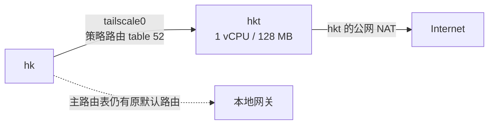

启用 Exit Node 之前，hk 访问公网走本地网关，公网地址也是原来的。启用之后，主路由表里那一行没有消失，变的是 Tailscale 插入的策略路由：另一张表接管了默认流量，`ip route get` 开始返回 `dev tailscale0`，公网服务看到的地址换成了 hkt 的托管出口。表面没动，流量已经换了方向。



这次的目标很窄：只有 hk 通过 hkt 访问互联网。没有引入第三台机器，没有把家宽设备、其他服务器或 SSH 隧道放进来，也没有在 hkt 上装代理软件。hkt 是一台资源很紧的 LXC 容器，1 个 vCPU，内存上限约 128 MB，它的角色只是接收 Tailscale 的出口流量再从自己的公网接口发出去。角色越单一，验证越容易；要是顺手把它改成 WireGuard、SOCKS5、家宽代理的大杂烩，故障边界立刻就模糊了。

在 hk 上执行 Exit Node 选择命令后，命令返回了成功。但那时候还不能宣布完成，因为几个状态字段并没有一起变成好看的样子：`ExitNodeID` 有值，另一个字段仍为空，`RouteAll` 也没有直接显示成我期待的状态。只看返回码，结论会来得很快；把实际流量拉出来看，结论才可靠。

我检查了策略规则和路由表。主表仍然保留原先的默认路由，Tailscale 另外加了优先级规则，把普通流量交给 table 52，而那张表里出现了：

```text
default dev tailscale0
```

再查具体目标：

```text
ip route get 1.1.1.1
```

返回的不是本地网卡，而是：

```text
1.1.1.1 dev tailscale0 table 52
```

这是"出口已经换了"的第一层证据。主路由表没被删掉，不代表流量还在走它——Linux 的策略路由本来就允许多张表并存，真正决定路径的是规则和查表顺序。

路由查询只能说明内核准备把包送到哪里，不能保证远端真的替你转发。于是我从 hk 发起普通 HTTPS 请求，几个互相独立的公网 IP 查询服务都返回了 hkt 的地址，而不是 hk 原来的。出口节点的意义不在于 Tailscale 状态栏上多了一个徽章，而在于互联网上的第三方看到了谁。

不过这个地址不是家宽 IP，它属于商业托管网络，IP 数据库把它标成 Business/Hosting 而不是 Residential。公开 DNSBL 查询当时没有命中，代理与 VPN 标记也没有命中，但这只能说明即时信誉信号还行，把机房地址包装成"住宅纯净 IP"就是另一回事了。

只测一次网页打开是不够的。出口节点处理的是 IP 流量，TCP、UDP、DNS 和 IPv6 不一定表现相同。普通 HTTPS 请求成功，远端服务看到的源地址是 hkt；一个持续返回多段内容的 HTTPS 长连接也完整跑完，响应里的源地址仍然是 hkt，说明连接没有在建立之后偷偷退回本地出口。接着用 HTTP/3 做了 QUIC 的基础测试，返回正常重定向——它不能证明所有 UDP 应用都没问题，但至少证明当前路径没有把 QUIC 直接挡在门外。hk 到 hkt 的 Tailscale 连接是直连 UDP，端口 41641；20 次 ICMP 测试没有丢包，平均往返约 2 ms。这个数值只描述当前这段测试窗口，替代不了一整天的吞吐、拥塞和重连观察，但足以说明当时没有经过高延迟的 DERP 中继。

验证也不能只盯着 IPv4。域名解析如果仍然走原来的链路，应用照样会暴露访问目标；IPv6 如果绕过 Exit Node，网页上的 IPv4 检测会给出一个很漂亮的假象。启用后，systemd-resolved 把 Tailscale DNS 链路标记为默认路由，`~.` 也指向了 Tailscale 的 DNS 范围，普通域名查询成功且解析结果来自 Tailscale 接口——这说明 DNS 配置跟着出口策略变了，但没有抓包，我不会把它夸大成"每一个查询都已端到端证明"。IPv6 方面，hk 没有可用的全局公网 IPv6，只有链路本地地址和 Tailscale 自己的地址；IPv6 公网测试失败，所有 IPv6 默认路由也落在 Tailscale 的策略表里。当前没有观察到 IPv6 从本地网卡绕出去，代价是 IPv6 公网访问暂时不可用。对于一个只要求稳定 IPv4 出口的节点，明确地没有 IPv6，通常比半开半漏更容易判断。

hkt 那边还有个我没法回避的问题：`memory.max` 只有 128 MB。启用出口节点后，`memory.current` 大约 98 MB，使用率约 77%，剩二十多 MiB；cgroup 的 `oom` 和 `oom_kill` 都是 0，内存压力的短期指标也是零。所以当时的结论不是"资源充足"，而是"目前没有出现明显压力"，这两句话差得很远。出口节点的内存消耗会随并发连接数、连接跟踪、Tailscale 状态和上层应用变化，一次成功的 HTTPS 不能证明它扛得住长时间跑满带宽。我没有因为看到 77% 就立刻扩容器，也没把它当成可以忽略的数字，先留着观察真实负载再说。

回滚只有一条命令：取消 hk 的 Exit Node 选择，默认路由就回到原来的本地网关。没有手工加 route，没有改 MTU，也没有动 hkt 的 SSH、防火墙或其他服务，所以回滚面很小。启用之前把路由、DNS、公网 IP 都存一份，启用之后重新读同一组指标，异常时按原状态回去——所谓网络透明，至少该先对操作者透明。

最后把范围说清楚：这次证明的是 hk 可以通过 hkt 的公网出口访问互联网，证明不了 hkt 的长期带宽质量，证明不了所有应用协议都正常，更证明不了这个商业 IP 具备住宅网络的信誉。网络配置最怕的不是复杂，而是把一次成功测试写成一项更大的能力。
