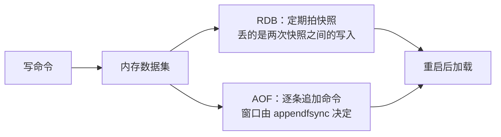

Redis 的数据在内存里，进程一停，内存就散了。所以持久化真正要回答的不是"要不要存"，而是出事以后你愿意退回哪一个时刻——丢几分钟能忍，还是最后一秒都不能丢。

RDB 的做法是拍快照：把某个时间点的整个数据集写成一份二进制文件。真正干活的是 `fork()` 出来的子进程，父进程照常接请求；写操作碰到共享内存页会触发写时复制，所以数据集越大、保存期间写入越猛，内存和延迟的压力越值得盯。这么存出来的文件很紧凑，丢给别人、拷到另一台机器都方便。



`save 900 1`、`save 300 10`、`save 60 10000` 是常见的触发写法，意思是"这么多秒里写了这么多次就存一次"。它是触发规则，不是承诺。快照还没写完、磁盘坏了、进程被杀了，都会改掉你最后真正拿到的东西。我第一次看到这三行时以为它规定了丢数据的上限，后来才明白它只规定了什么时候开始存。

AOF 是另一种思路：不存结果，存过程。每一条改变数据集的命令都追加进日志，重启时把日志重放一遍。日志会长，所以 Redis 会在后台用当前数据集重写成一段更短的命令序列——这一步同样可能 `fork()`。

`appendfsync` 决定什么时候要求把 AOF 落到磁盘。`everysec` 是每秒一次，大多数人停在这里，它确实是个折中；但异常断电时，那一秒里还没落盘的部分仍然会丢。而且"一秒"是 Redis 提出的要求，不是你那块盘、那个文件系统的保证。`always` 每写一次就同步，安全得多，代价写在写入延迟上；`no` 把时机交给操作系统，那就得相信它。到底慢多少，只能在自己的负载和盘上量。

Redis 7.2 的 AOF 重写可以用 RDB 做前导段，后面接增量命令。要不要用、文件现在是什么格式、启动时怎么加载，都得按你装的版本和实际配置看。把一个版本的默认值当成所有 Redis 的默认行为，是这类文章里最常见的一种错。

怎么选，我的办法是先把问题倒过来问：能接受丢多少数据，多久必须恢复。这两个答案定下来，快照周期、同步策略和备份保留方式才有得挑。RDB 适合定期快照和异机备份，文件小、恢复路径直；AOF 适合"我连最后几秒都不想丢"的场合，恢复时间随日志大小和重放量走。两个一起开也不等于零丢失，它只是把窗口压小，压不到没有。

下面这组是 Redis 7.2 的配置示意，具体值按数据量、写入量和磁盘调；它不是我的生产配置，我也没在这台机器上跑过：

```ini
appendonly yes
appendfsync everysec
aof-use-rdb-preamble yes

save 900 1
save 300 10
save 60 10000
stop-writes-on-bgsave-error yes
rdbcompression yes
rdbchecksum yes
```

`stop-writes-on-bgsave-error yes` 我特意留着：后台存快照失败时直接拒绝写入，总比继续收写入、让你以为快照还在更新要好。代价也很实在——数据写不进去，业务可能先报错，这笔账得和告警一起算。至少盯着最近一次 RDB 的保存状态（`rdb_last_bgsave_status` 之类），并且隔一段时间真的拿备份恢复一次；没恢复过的备份只是文件。

我写不出"10GB 要几秒"这种句子，因为没有可复核的基准。真要压测，把 Redis 版本、数据集大小、写入模式、存储设备、配置和恢复时间一起记下来，RDB 和 AOF 才在同一张桌上比较。

参考：[Redis 持久化文档](https://redis.io/docs/latest/operate/oss_and_stack/management/persistence/) · [Redis 持久化与耐久性教程](https://redis.io/tutorials/operate/redis-at-scale/persistence-and-durability/)
