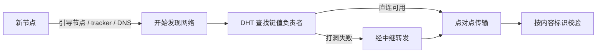

P2P 常被一句话概括成"没有中心服务器"。这句话省掉的东西不少：新节点从哪里入网，数据怎样找到并到达目标，参与者又为什么愿意继续把带宽拿出来。把这几件事分开看，才看得清去中心化省下了什么，又把复杂度挪到了哪里。

第一次加入网络的节点通常需要一个入口：预置的引导节点、tracker、DNS，或者别人给的地址。入口的作用只是让它开始发现网络，数据索引和实际传输可能由完全不同的机制承担。有些入口由少数服务维护，这确实形成依赖，但不等于所有 P2P 数据都要经过它们——入口能不能换、节点列表能不能更新，决定了这份依赖有多脆。

查找这一步，眼下主流做法是分布式哈希表（DHT）：把一个键映射到负责该键的一组节点。Kademlia 用 XOR 距离组织路由表，查询时不断向更接近目标键的节点追问。在路由表和节点可达性满足算法假设时，查找步数随网络规模呈对数级增长；但现实里的节点会离线、路由信息会过期，恶意节点也可能干扰查询，所以它不是"每一步距离必然减半"的保证。还有一点常被混在一起：DHT 只解决"谁负责这个键"，它本身不保证数据真实，也不等于加密、匿名或共识。

传输要面对的另一件事是 NAT。很多设备在 NAT 或防火墙后面，外部节点根本连不进来，打洞能在一些网络组合里建立直连，结果取决于 NAT 类型、协议和网络策略——我没法用一个固定成功率概括它。直连失败时应用可能退回中继：连接能继续工作，代价是带宽成本和一条额外的路径，部分场景还会有延迟变化。中继是实现选择，不是每条 P2P 连接的必经环节。

拿 BitTorrent 举例，它把文件切块，再从多个节点分别取；DHT 可以帮助发现参与者，tracker 也仍然是一种发现方式。内容校验用来确认收到的数据符合它声明的标识，不能证明文件来源可信、更不能证明内容合法。BitTorrent v2 用的是一套基于 SHA-256 的内容哈希机制，所以"磁力链接一律是 SHA-1"这种说法现在已经不成立。

至于资源交换，"上传换下载"只是对 BitTorrent 的一种简化描述，不能当成所有客户端都严格执行的协议承诺。资源稀缺时，上传者更容易拿到回报；资源充足时，用户可能就少传了，客户端的选块和连接策略也会影响结果。网络能长期转下去，还靠种子保留、社区习惯和一批长期在线的节点，不只靠某一个激励算法。

所以 P2P 适合的是数据分发这类多对多传输，尤其是很多参与者都能贡献带宽的场合。需要强一致写入、可预测低延迟或者稳定在线能力的系统，通常还要另外设计协调、冗余和故障处理；区块链则是在 P2P 通信之上又加了共识和状态复制，普通 P2P 网络里并不必然有这些。

我更愿意把它当成一次部署与信任边界的选择。设计时具体问几句：引导入口失效了怎么办，数据由谁校验，节点退出后谁补位，允不允许中继，带宽谁承担。答案不同，"去中心化"的实际程度也不同。

参考：[RFC 5694：Peer-to-Peer (P2P) Architecture](https://www.rfc-editor.org/rfc/rfc5694) · [BitTorrent DHT 协议](https://www.bittorrent.org/beps/bep_0005.html) · [Kademlia 论文](https://pdos.csail.mit.edu/~petar/papers/maymounkov-kademlia.pdf) · [BitTorrent v2](https://www.bittorrent.org/beps/bep_0052.html)
